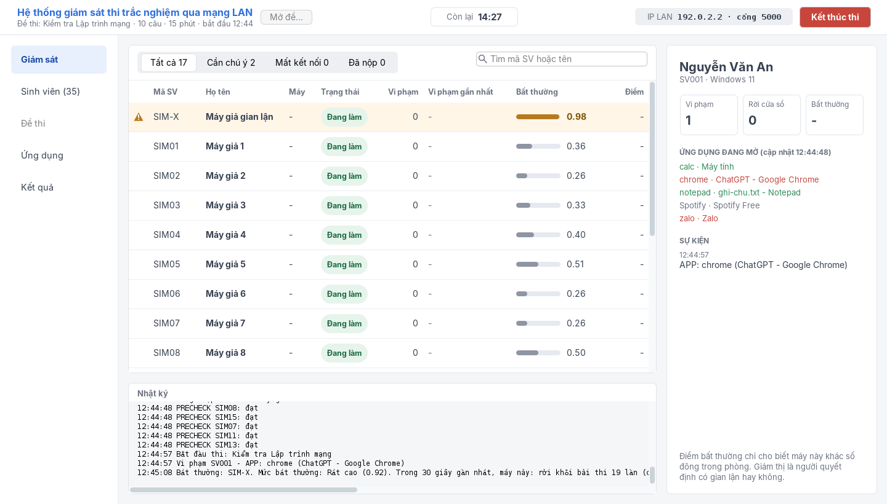
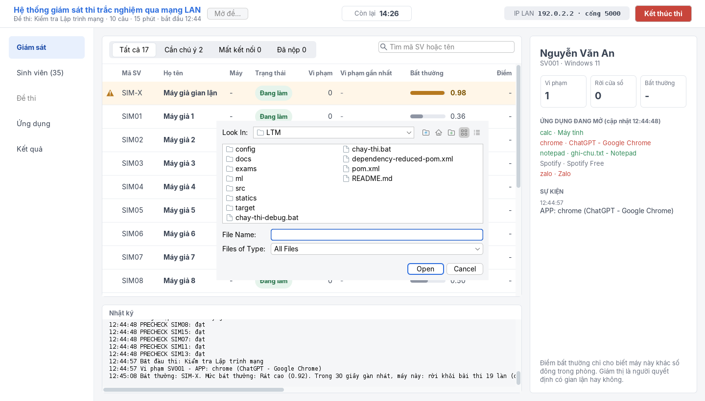
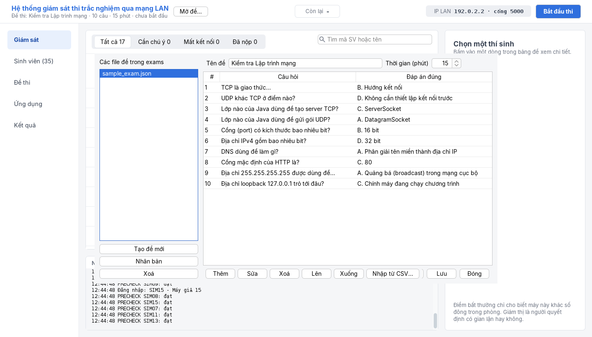
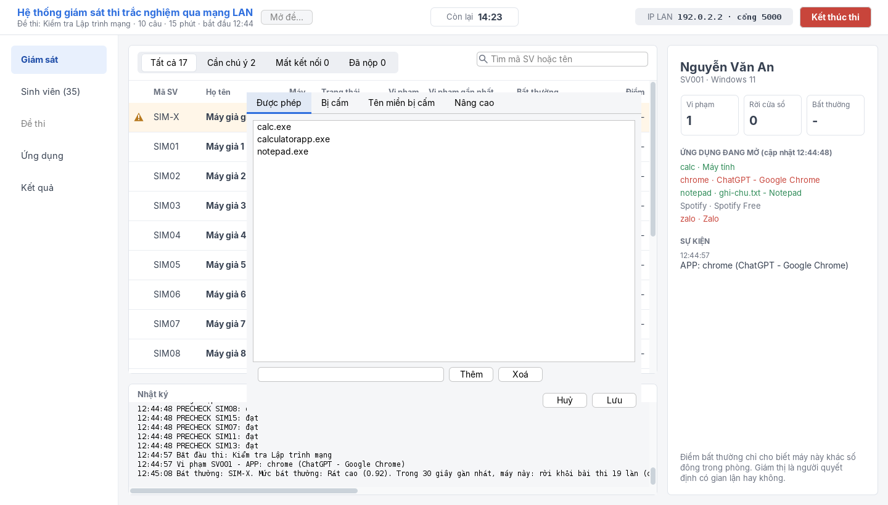
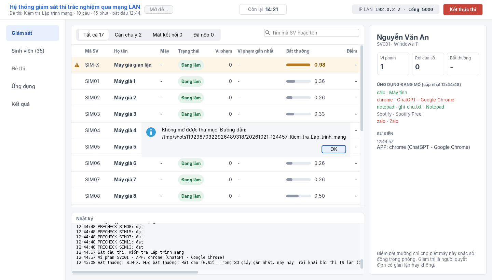
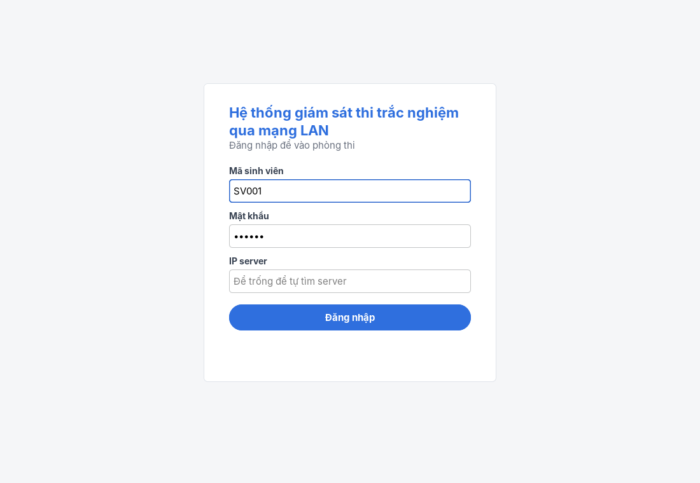
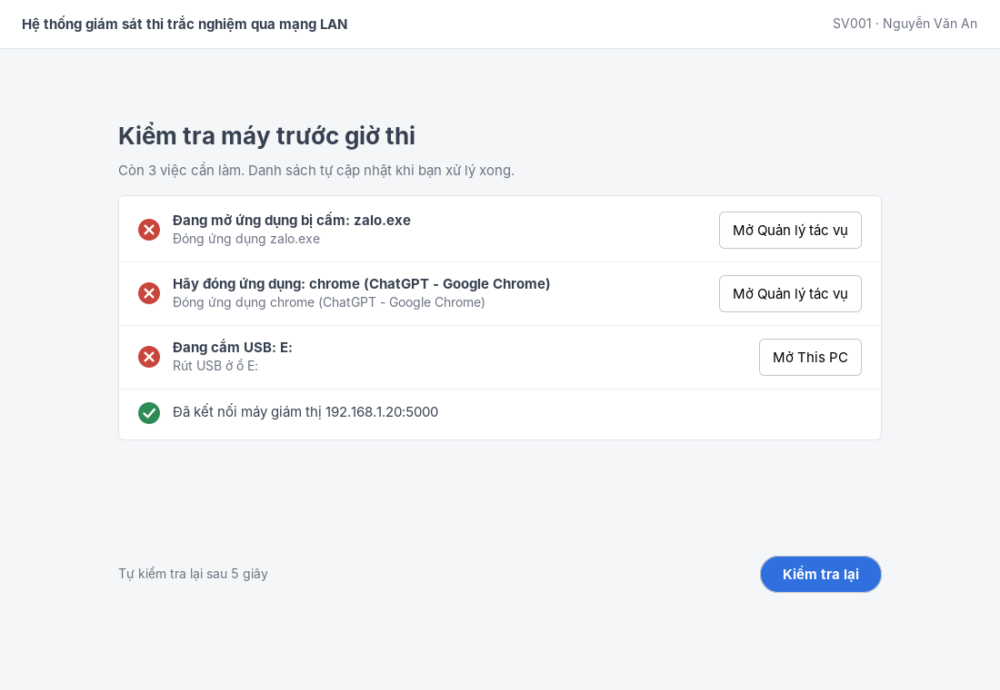
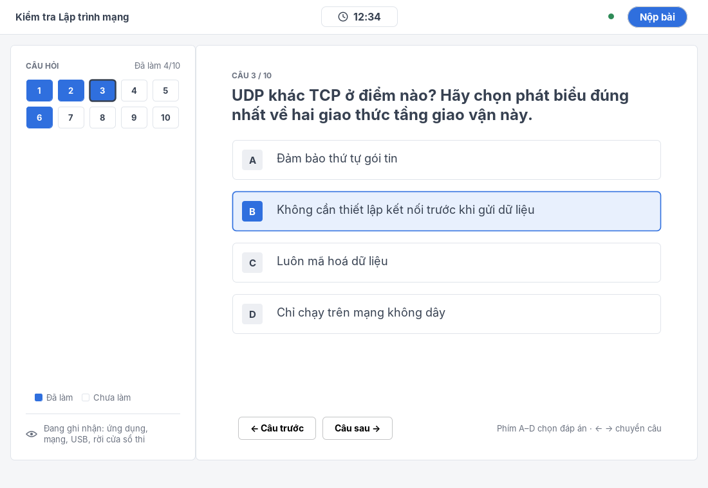
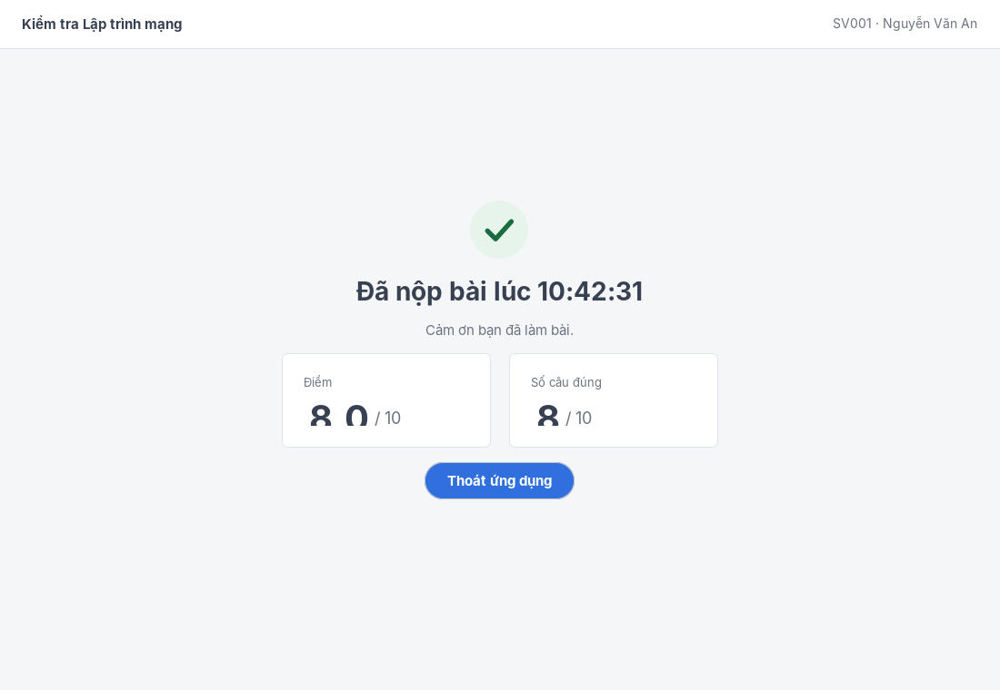

# LTM - Hệ thống giám sát thi trắc nghiệm qua mạng LAN

Ứng dụng thi trắc nghiệm trong mạng LAN (bài tập lớn môn Lập trình mạng). Hệ thống chạy trong mạng LAN; khi làm từ xa thì dùng ZeroTier để tạo LAN ảo. Giáo viên chọn file đề và bắt đầu thi, sinh viên làm bài trên client Windows.
Trong giờ thi, client giám sát bằng luật (app ngoài whitelist, kết nối tới địa chỉ bị cấm, cắm USB, rời cửa sổ thi) và gửi dữ liệu về server.
Server gửi dữ liệu cả phòng sang service Python dùng Isolation Forest để tìm máy có hành vi khác biệt so với số đông; giám thị là người quyết định có gian lận hay không.

Đặc tả đầy đủ: [docs/AGENT_BRIEF.md](docs/AGENT_BRIEF.md).

## 1. Kiến trúc

```
  Client Windows (StudentApp + Monitor)  x N
        |   ^
        |   |  UDP 9999: EXAM_DISCOVER / EXAM_SERVER <cổng>   (tìm server)
        v   |  TCP 5000: mỗi tin nhắn là một dòng JSON UTF-8
  +------------------------------------------+
  | Server (ExamServer + TeacherWindow)      |  Linux hoặc Windows
  +------------------------------------------+
        |   ^
        v   |  HTTP 8000 (chỉ localhost): POST /score
  +------------------------------------------+
  | Service ML (FastAPI + Isolation Forest)  |
  +------------------------------------------+
```

Client chỉ phát hiện và báo cáo: không chặn mạng, không kill tiến trình, không cần quyền admin. Đáp án đúng chỉ nằm ở server.

## 2. Phân công

| Vai | File | Mảng phụ trách | Cần hiểu |
|---|---|---|---|
| Cả nhóm | `common/Protocol.java` (do Server 1 giữ) | Giao thức chung | - Mỗi tin nhắn là một dòng JSON, luôn có `type`<br>- Gson tự escape ký tự xuống dòng nên không bao giờ vỡ dòng |
| Server 1 (lõi mạng) | `ExamServer`, `ClientHandler`, `ExamRoom`, `Session`, `ExamLog`, `common/Protocol` | Nhận kết nối, luật phòng thi, watchdog, ghi `events.csv`/`server.log` | - `ExamRoom` giữ mọi trạng thái và mọi phương thức đổi trạng thái đều `synchronized`; `trySendExam` là điểm gửi đề duy nhất<br>- Chống nhầm session cũ và mới (so sánh socket); watchdog 90 giây (chỉ tính từ lúc máy nhận đề)<br>- Mỗi client một luồng; TCP cho nghiệp vụ, UDP chỉ để tìm server |
| Server 2 (giao diện giám thị và dữ liệu) | `TeacherWindow`, `SideBar`, `RosterTable`, `Roster`, `DetailPanel`, `HistoryDialog`, `Pill`, `TabButton`, `LocalAddresses`, `RulesDialog`, `ListEditor`, `RulesFile`, `ExamFile`, `ExamBank` (+ `ExamBankDialog`, `QuestionDialog`), `StudentList`, `common/Icons`, `Palette`, `Format`, `Html`, `Card`, `Look` | Cửa sổ giám thị, soạn đề, danh sách sinh viên, luật, chấm điểm, `results.csv` | - Bảng cập nhật bằng `Timer` 1 giây trên luồng giao diện; `Roster` là logic thuần nên test được<br>- Đáp án chỉ ở server (`ExamFile.questionsForClient`); chấm điểm và `ket-qua/<kỳ thi>/` (CSV UTF-8 có BOM)<br>- Sửa luật giữa giờ: `RulesFile` rồi `RULES_UPDATE` |
| Client | toàn bộ `client/`: `StudentApp`, `StudentScreens` (+ `Theme`, `TopBar`, `LoginPanel`, `PrecheckPanel`, `ExamPanel`, `NumberButton`, `OptionRow`, `ResultPanel`, `Sheet`), `ServerConnection`, `ServerFinder`, `Monitor`, `AppRules`, `WindowsProbe`, `Diagnose`, `Debug`; `config/rules.json` | Client sinh viên và giám sát: giao diện làm bài (FlatLaf), kết nối, phát hiện vi phạm | - Luồng màn hình: đăng nhập, PRECHECK, chờ, làm bài, kết quả; tự kết nối lại mỗi 5 giây<br>- Baseline lấy ở PRECHECK, so sánh mỗi 3 giây; vì sao chỉ xét app có cửa sổ và cần `SYSTEM_PROCESSES`<br>- 6 feature mỗi chu kỳ server cấp; `WindowsProbe` chạy lệnh Windows, `Monitor` chỉ chứa luật nên test được trên Linux |
| ML và thực nghiệm | `ml/ml_service.py`, `ml/test_ml_service.py`, `ml/simulate_clients.py`, `MlClient`, `MlScores` | Isolation Forest, lý do bất thường, giả lập phòng thi, nối Java với Python | - Không giám sát, fit trên chính dữ liệu buổi thi; điểm min-max và 3 cửa sổ gần nhất<br>- Vì sao `anomaly` có thêm điều kiện điểm ≥ 0.7 (xem mục 9)<br>- ML chỉ cảnh báo; gọi HTTP ngoài khối `synchronized` để ML chậm không treo server |

Cấu trúc mã nguồn (mỗi file Java trong `src/main` dài khoảng 280 dòng trở xuống; cần thì tách file mới):

```
src/main/java/exam/
  common/   Protocol  Palette  Look  Card  Icons  Format
  client/   StudentApp  StudentScreens  Theme  TopBar  LoginPanel  PrecheckPanel  ExamPanel  NumberButton  OptionRow  ResultPanel  Sheet
            ServerConnection  ServerFinder  Monitor  AppRules  WindowsProbe  Diagnose  Debug
  server/   ExamServer  ExamRoom  ExamLog  Session  ExamFile  StudentList  RulesFile  RulesDialog  ListEditor  ExamBank  ExamBankDialog  QuestionDialog  ClientHandler  TeacherWindow  RosterTable  Roster  DetailPanel  HistoryDialog  MlClient
            Pill  TabButton  SideBar  LocalAddresses
ml/         ml_service.py  simulate_clients.py  test_ml_service.py
config/     rules.json  lop-mau.csv        exams/   sample_exam.json        src/main/resources/exam/theme/FlatLaf.properties
```

## 3. Giao thức

**UDP 9999 (tìm server):** client gửi `EXAM_DISCOVER` tới `255.255.255.255`, broadcast từng card mạng và `127.0.0.1`; server trả `EXAM_SERVER <cổng TCP>` về đúng người gửi. Hết 3 giây không có trả lời hợp lệ thì client báo không tìm thấy.

**TCP 5000:** một dòng JSON UTF-8 mỗi tin nhắn.

| Chiều | type | Trường | Ghi chú |
|---|---|---|---|
| C→S | `LOGIN` | `studentId`, `password`, `os`, `name` | `os` (tên hệ điều hành, tuỳ chọn) hiện ở cột Máy của giám thị; `name` chỉ có tác dụng khi server chưa nạp danh sách sinh viên (client không gửi, server lấy mã SV làm tên) |
| S→C | `LOGIN_OK` | `rules`, `name`, `featureIntervalSeconds` | Luật do server gửi xuống; `name` là họ tên trong danh sách sinh viên |
| S→C | `LOGIN_FAIL` | `reason` | Sai mã SV hoặc mật khẩu thì `reason` luôn là `Sai mã sinh viên hoặc mật khẩu` (không nói rõ sai cái nào) |
| C→S | `PRECHECK_RESULT` | `ok`, `issues` | Có thể gửi nhiều lần |
| S→C | `EXAM_START` | `title`, `remainingSeconds`, `questions` | Câu hỏi không có `answer` |
| C→S | `VIOLATION` | `kind` (`APP`/`NET`/`USB`), `detail`, `time` | |
| C→S | `FEATURES` | `window`, `values` (đúng 6 số) | Mỗi `featureIntervalSeconds` giây (server cấp trong `LOGIN_OK`, mặc định 30), đồng thời là heartbeat |
| S→C | `RULES_UPDATE` | `rules` (toàn bộ luật mới) | Gửi cho mọi máy đang kết nối khi giám thị lưu luật; client áp dụng ngay, KHÔNG lấy lại baseline |
| C→S | `APPS` | `apps` (danh sách `{name, title}` các app có cửa sổ) | Gửi lúc PRECHECK, rồi cứ 15 giây kiểm tra một lần và chỉ gửi khi danh sách đổi; Linux gửi danh sách rỗng. Server giữ bản mới nhất kèm giờ cập nhật (tối đa 100 dòng) |
| C→S | `SUBMIT` | `answers` | Khoá = id câu, giá trị = chỉ số lựa chọn từ 0 |
| S→C | `EXAM_END` | `reason` | Client nhận được thì tự `SUBMIT` |
| S→C | `RESULT` | `score`, `correct`, `total`; khi bị đình chỉ có thêm `terminated: true` và `reason` (vi phạm cuối cùng, vd `Vi phạm APP: zalo.exe`) | Gửi lại đúng tin này mỗi khi đăng nhập lại |

Dòng không phải JSON object, `type` lạ, và mọi tin (trừ `LOGIN`) trước khi đăng nhập đều bị bỏ qua, không đóng kết nối.

**HTTP 8000:** `POST /score` với `{"samples": [{"studentId", "window", "values"}]}` trả `{"status": "ok", "results": [{"studentId", "score", "anomaly"}]}`, hoặc `{"status": "not_enough_data", "results": []}` khi dưới 20 mẫu. `values` sai độ dài thì trả 422.

Sáu giá trị của `values`: số tiến trình mới, số lần rời cửa sổ, số giây rời cửa sổ, số IP đích mới, số vi phạm, số lần chọn/đổi đáp án.

## 4. Cài đặt

- **Máy server:** JDK 17+ và Maven; Python 3.10+.
- **Máy client (Windows):** chỉ cần Java 17+ (JRE là đủ) và **2 file** cùng thư mục: `exam.jar` và `chay-thi.bat`. Sinh viên nhấp đúp `chay-thi.bat` để mở bài thi (không có cửa sổ terminal đi kèm). Terminal (cmd, PowerShell, Windows Terminal) mở trong giờ thi bị PRECHECK/giám sát báo vi phạm; `git`, `curl`, `ssh`... và `github.com` cũng bị cấm trong `config/rules.json`.
- **Thư viện Java** (Maven tự tải, shade plugin gói hết vào `exam.jar` nên client chỉ cần một file): Gson 2.11.0 (JSON) và **FlatLaf 3.7.2** (giao diện Swing hiện đại; cả client và server cài qua `Look.install()`).
- **Python:**
  ```bash
  python3 -m venv ml/.venv
  source ml/.venv/bin/activate          # Windows: ml\.venv\Scripts\activate
  pip install -r ml/requirements.txt
  ```

## 5. Build và chạy

Chạy từ thư mục gốc repo, theo thứ tự ML, server, client:

```bash
mvn -q package                                                   # tạo target/exam.jar (đã gói kèm Gson)
cd ml && uvicorn ml_service:app --host 127.0.0.1 --port 8000     # 1. service ML
java -cp target/exam.jar exam.server.ExamServer                  # 2. server (đọc config/rules.json)
java -Dexam.allowTerminal=true -cp target/exam.jar exam.client.StudentApp   # 3. client (dev: chạy từ terminal nên phải bật cờ này; máy thi dùng chay-thi.bat)
```

Chạy test: `mvn -q test` và `cd ml && python -m pytest -q`.
Giả lập thêm máy để demo: `cd ml && python simulate_clients.py --count 5 --cheater` (thêm `--interval 3` để thấy kết quả nhanh).
Mỗi kỳ thi có một thư mục riêng `ket-qua/<yyyyMMdd-HHmmss>_<tên đề không dấu>/` (tạo khi giáo viên bấm Bắt đầu thi, nằm ở thư mục chạy server), gồm `results.csv`, `events.csv` và `server.log`. Hai file CSV là UTF-8 có BOM nên Excel đọc được tiếng Việt. Không còn `results.csv` ở thư mục gốc.
`events.csv` có các cột `time,studentId,name,type,detail`, mỗi sự kiện ghi và flush ngay một dòng; sự kiện xảy ra trước khi bấm Bắt đầu (đăng nhập, PRECHECK) được giữ trong bộ nhớ và ghi vào file khi thư mục được tạo. Các `type`: `LOGIN`, `RECONNECT`, `LOGIN_FAIL`, `PRECHECK_FAIL` (detail là danh sách vấn đề), `PRECHECK_OK`, `EXAM_SENT`, `VIOLATION`, `ANOMALY_ON`, `ANOMALY_OFF`, `DISCONNECT`, `SUBMIT`, `EXAM_END` (sự kiện của cả phòng, `studentId` rỗng). `server.log` là toàn bộ log của cửa sổ giám thị.
Bấm vào một sinh viên thì khung chi tiết bên phải có thêm phần **Ứng dụng đang mở (cập nhật hh:mm:ss)**: mỗi app một dòng gồm tên và tiêu đề cửa sổ; app bị cấm tô đỏ, app được phép tô xanh, app chưa có trong danh sách nào màu xám (bỏ các tiến trình hệ thống và `java`).
Trên cửa sổ giám thị, nhấp đúp vào một dòng để xem lịch sử của thí sinh đó (giờ, loại, chi tiết, lấy từ bộ nhớ); nút **Mở thư mục kết quả** mở thư mục của kỳ thi (không mở được thì hiện đường dẫn).

### Tài khoản sinh viên

Sinh viên đăng nhập bằng **mã SV và mật khẩu** (không còn ô Họ tên; họ tên lấy từ danh sách và server gửi về trong `LOGIN_OK`). Danh sách là file CSV UTF-8 (có hoặc không có BOM), dòng đầu là `studentId,name,password`, mỗi sinh viên một dòng, đúng 3 cột (không dùng dấu phẩy trong giá trị), không trùng mã SV. File mẫu `config/lop-mau.csv` có `SIM01`..`SIM30`, `SIM-X` và 4 tài khoản test `SV001`..`SV004`, mật khẩu `123456`.
- Giám thị bấm **Sinh viên** ở thanh bên để xem danh sách (mã SV, họ tên, mật khẩu) rồi bấm **Nhập file CSV...** để chọn file; mỗi dòng lỗi được báo `Dòng n: lý do` (tối đa 10 lỗi) và không nạp gì. Nạp được thì danh sách chỉ nằm trong bộ nhớ của server, **không lưu ra file**: mỗi lần mở server phải nạp lại CSV (ví dụ `config/lop-mau.csv`). Nút **Bắt đầu thi** bị khoá (tooltip `Nạp danh sách sinh viên trước`) khi chưa có danh sách.
- So khớp mã SV không phân biệt hoa thường và bỏ khoảng trắng. Sai mã SV hoặc mật khẩu: `LOGIN_FAIL` kèm sự kiện `LOGIN_FAIL` trong `events.csv`.
- Chưa nạp danh sách: mọi `LOGIN` bị từ chối bằng `LOGIN_FAIL` lý do `Giám thị chưa nạp danh sách sinh viên`, giao diện hiện dải cảnh báo vàng.
- Giả lập: `python simulate_clients.py --password 123456` (mặc định `123456`).
- Chỉ sinh viên có trong danh sách mới hiện ở tab Giám sát: nạp danh sách mới (chỉ khi chưa bắt đầu thi) thì phiên có mã SV ngoài danh sách bị xoá khỏi phòng và đóng kết nối.
- Máy giả `simulate_clients.py` cũng phải có tên trong file CSV nạp vào (SIM01…, SIM-X; `config/lop-mau.csv` đã có sẵn).
- Mọi sinh viên trong danh sách đều hiện trên bảng Giám sát: ai chưa đăng nhập có trạng thái `Chưa vào` (chữ xám, tab **Chưa vào**, không tính vào Cần chú ý); khi kết thúc thi, `results.csv` thêm một dòng `Vắng` (điểm để trống) cho mỗi người chưa vào.

### Quản lý đề

Nút **Quản lý đề...** (chỉ bấm được khi bài thi chưa bắt đầu) mở hộp thoại: bên trái là các file `exams/*.json` kèm **Tạo đề mới**, **Nhân bản**, **Xoá** (có hỏi xác nhận); bên phải là tên đề, thời gian (phút) và bảng câu hỏi với **Thêm**, **Sửa**, **Xoá**, **Lên**, **Xuống**. Mỗi câu có nội dung, 2 đến 6 lựa chọn (ô trống bị bỏ qua) và một đáp án đúng. **Lưu** ghi file JSON đúng định dạng cũ, `id` tự đánh số lại từ 1; file được ghi ra file tạm và kiểm tra bằng `ExamFile.load` rồi mới thay file thật, nên đề sai không làm hỏng file cũ. **Dùng đề này** nạp đề đã lưu vào phòng thi.
**Nhập từ CSV...** thêm câu hỏi vào đề đang soạn từ file UTF-8 có dòng đầu `question,optionA,optionB,optionC,optionD,answer` (`answer` là A-D, ô có dấu phẩy thì bọc nháy kép, C và D có thể để trống); dòng lỗi được báo `Dòng n: lý do`.

### Kỳ thi mới không cần tắt server

Sau khi bấm **Kết thúc thi**, nút **Kỳ thi mới** (có hộp xác nhận) đóng kết nối các máy còn lại (máy chưa nộp được gửi `EXAM_END` trước), xoá phiên, mẫu ML và bộ đếm, đưa phòng về trạng thái ban đầu nhưng **giữ đề đang nạp**. Nút **Chọn file đề...** dùng được bất cứ lúc nào bài thi chưa bắt đầu (kể cả sau Kỳ thi mới). Kết quả và lịch sử kỳ trước vẫn nằm nguyên trong thư mục `ket-qua/` riêng của nó; kỳ mới tạo thư mục mới khi bấm Bắt đầu.
Ở client, màn kết quả chỉ có điểm, lời cảm ơn và nút **Thoát ứng dụng** (không còn nút Thi lượt mới). Muốn thi kỳ mới thì **tắt app rồi mở lại** (nhấp đúp `chay-thi.bat`). Đăng nhập lại cùng mã SV khi đã nộp trong kỳ hiện tại thì server gửi `LOGIN_OK` rồi `RESULT` cũ ngay (không cần PRECHECK, không gửi đề); sau **Kỳ thi mới** phòng trống nên mã SV cũ là người mới. Cần gửi `exam.jar` mới (kèm `chay-thi.bat`) cho các máy Windows.

### Đình chỉ khi vi phạm

- Chỉ **vi phạm luật** (tin `VIOLATION` loại APP, NET, USB) mới bị đình chỉ. PRECHECK lỗi trước giờ thi không tính. Điểm Bất thường của ML **không bao giờ** kết thúc bài thi của ai, chỉ hiện cảnh báo trên cửa sổ giám thị.
- Khoá `maxViolations` trong `config/rules.json` (mặc định `1`): vi phạm đủ số lần này thì bị đình chỉ ngay. `0` (hoặc thiếu) là tắt đình chỉ, chỉ cảnh báo. Đổi được giữa giờ qua `RULES_UPDATE`.
- Khi bị đình chỉ: trạng thái `Đình chỉ` (đỏ đậm, nằm trong tab Cần chú ý), coi như đã nộp với 0 điểm (`correct` = 0, `total` = số câu), gửi `RESULT` có `terminated: true` và `reason`, ghi sự kiện `TERMINATED` vào `events.csv`, `results.csv` có `status` = `Đình chỉ` và `score` = 0, log `Đình chỉ: <mã SV> – <lý do>`.
- Sau đó mọi `SUBMIT`, `FEATURES` và `VIOLATION` của phiên bị bỏ qua. Đăng nhập lại thì chỉ nhận lại đúng `RESULT` đó. Không có chức năng gỡ đình chỉ hay cho thi tiếp. Client hiện màn đỏ `Bài thi bị đình chỉ`, lý do, điểm `0 / 10` và dừng giám sát.
- **Lý do thiết kế:** luật dựa trên bằng chứng rõ ràng (mở app bị cấm, vào tên miền cấm, cắm USB) nên tự đình chỉ được. ML chỉ cho biết máy khác số đông (có thể chỉ vì học khác cách), không phải bằng chứng, nên chỉ cảnh báo để giám thị quyết định.

### Watchdog chỉ tính sau khi nhận đề

Server coi máy `Đang thi` là mất kết nối khi quá 90 giây không nhận tin nào, tính từ `lastSeen`. Trước giờ thi client không gửi gì, nên `lastSeen` được đặt lại đúng lúc server gửi `EXAM_START` (`ExamRoom.trySendExam`); máy chờ lâu trước khi bấm Bắt đầu không bị đá nữa.
`results.csv` có thêm cột `samples` (số FEATURES server đã nhận từ máy đó) và `flaggedCount` (số lần chấm mà máy bị gắn cờ).
Bảng giám thị không hiển thị số mẫu (vẫn lưu ở cột `samples` của `results.csv`); log ghi `Bất thường: <mã SV>. <câu giải thích>` / `Hết bất thường: <mã SV>` khi đổi trạng thái và `ML: chưa đủ dữ liệu (n/20 mẫu)` khi n đổi.
Debug client: nhấp đúp `chay-thi-debug.bat` (hoặc thêm `-Dexam.debug=true`; chạy từ terminal thì thêm cả `-Dexam.allowTerminal=true`) để in thời gian mỗi lần quét và nội dung mỗi FEATURES ra stderr.

### Luật ứng dụng và khi bị báo vi phạm oan

Client chỉ kiểm soát **app có cửa sổ**; tiến trình nền không bao giờ là vi phạm (chỉ được đếm vào feature `newProcesses`). Tên so khớp không phân biệt hoa thường và bỏ đuôi `.exe` (`Antigravity.exe` khớp `antigravity`).

| Thời điểm | Trường hợp | Kết quả |
|---|---|---|
| PRECHECK | App trong `blacklistApps` đang chạy | Không đạt: `Đang mở ứng dụng bị cấm: <tên>` |
| PRECHECK | App có cửa sổ, không thuộc `whitelistApps`/`allowedWindowApps` | Không đạt: `Hãy đóng ứng dụng: <tên> (<tiêu đề>)` |
| Trong giờ thi | App trong blacklist xuất hiện | Vi phạm `APP` |
| Trong giờ thi | Tiến trình mới có cửa sổ, không được phép | Vi phạm `APP`, detail `<tên> (<tiêu đề>)` |
| Trong giờ thi | Tiến trình mới không có cửa sổ | Không vi phạm, chỉ đếm vào `newProcesses` |
| Mọi lúc | Thuộc `ignoreProcesses` hoặc `SYSTEM_PROCESSES` | Bỏ qua hoàn toàn |

Luật nằm trong `config/rules.json` **ở server** và được gửi xuống client lúc đăng nhập, nên chỉnh luật **không cần build lại hay gửi lại jar**; chỉ cần khởi động lại server. Các khoá: `blacklistApps`, `whitelistApps`, `allowedWindowApps`, `ignoreProcesses`, `blockedDomains`.

**Sửa luật ngay trên giao diện giám thị:** nút **Quản lý ứng dụng...** mở hộp thoại 4 tab (`Được phép` = `whitelistApps`, `Bị cấm` = `blacklistApps`, `Tên miền bị cấm` = `blockedDomains`, `Nâng cao` = `allowedWindowApps` và `ignoreProcesses`). Bấm Lưu thì ghi lại `config/rules.json` (các khoá khác giữ nguyên, file được định dạng lại mỗi mục một dòng) và gửi `RULES_UPDATE` cho các máy đang kết nối: client đổi luật ngay, app vừa bị cấm mà đang mở sẽ bị báo vi phạm `APP` ở lần quét kế tiếp. Chuột phải vào một app trong phần "Ứng dụng đang mở" có menu `Cho phép ứng dụng này` / `Cấm ứng dụng này` (tên được gỡ khỏi các danh sách app khác rồi thêm vào `whitelistApps` hoặc `blacklistApps`). `featureIntervalSeconds` chỉ đọc lúc khởi động server.

**Khi bị báo vi phạm oan:**
1. Trên máy Windows bị báo, chạy `java -cp exam.jar exam.client.Diagnose` (khi máy đang ở trạng thái thi bình thường). Công cụ ghi file `chan-doan-<tên máy>.txt`.
2. Mở file: mục "App đang có cửa sổ" cho biết app nào làm PRECHECK không đạt hoặc bị báo `APP`; mục "Tiến trình KHÔNG có cửa sổ" có sẵn một dòng JSON các tiến trình nền.
3. Thêm tên (chỉ những tên chắc chắn là phần mềm lành) vào `ignoreProcesses` (bỏ qua hẳn) hoặc `allowedWindowApps` (cho phép có cửa sổ) trong `config/rules.json` ở server.
4. Khởi động lại server; sinh viên đăng nhập lại là nhận luật mới.

### Giao diện

Màu, khoảng cách (lưới 8px) và bo góc (12px) nằm ở một chỗ: `exam.common.Palette` (màu, `GAP`, `RADIUS`), `exam/theme/FlatLaf.properties` trong resources (bo góc, thanh cuộn) và `exam.common.Look.install()` ghép hai thứ đó cho cả client lẫn giám thị. Font Segoe UI trên Windows, Inter trên Linux nếu có, không thì mặc định. Nội dung đặt trong thẻ trắng viền mảnh (`exam.common.Card`) trên nền xám nhạt. Ảnh chụp bằng Xvfb trong `statics/results/ui/` (giám thị: 15 máy giả + 1 máy giả gian lận + 1 máy gửi `APPS`; ảnh PRECHECK của client dùng dữ liệu mẫu vì phần quét chỉ chạy trên Windows).

Cửa sổ giám thị: thanh bên trái có 5 mục `Giám sát` (màn hình hiện tại), `Sinh viên` (nhập danh sách), `Đề thi` (quản lý đề, tắt khi đã bắt đầu thi), `Ứng dụng` (quản lý ứng dụng), `Kết quả` (mở thư mục kết quả); thanh trên cùng có tên đề tài, đề đang mở, đồng hồ, `IP LAN` và nút Bắt đầu/Kết thúc.

| Giám sát | Sinh viên (nhập danh sách) |
|---|---|
|  |  |

| Đề thi | Ứng dụng |
|---|---|
|  |  |

| Kết quả (máy ảo không có trình quản lý file nên hiện đường dẫn) |
|---|
|  |

| Client: đăng nhập | Client: PRECHECK không đạt |
|---|---|
|  |  |

| Client: làm bài | Client: kết quả |
|---|---|
|  |  |

Mẫu `events.csv`: [events-mau.csv](statics/results/events-mau.csv).
Phím tắt khi làm bài: `1`-`9` hoặc `A`-`I` chọn đáp án, mũi tên trái/phải chuyển câu.

## 6. Mạng

- **Làm ở nhà:** ZeroTier (gói Personal miễn phí), 4 máy join cùng một network. Không dùng Tailscale (không hỗ trợ broadcast) hay Radmin VPN (không có bản Linux). Nếu UDP không tìm được server, nhập một trong các IP LAN của máy server (nhãn `IP LAN` ở thanh trên cùng của cửa sổ giám thị, có cả IP của card ZeroTier).
- **Hôm demo:** cả 4 máy bắt chung một hotspot điện thoại.
- **Firewall Fedora:** `sudo firewall-cmd --add-port=5000/tcp --add-port=9999/udp` (thêm `--permanent` rồi `--reload` nếu muốn giữ).
- **Firewall Windows:** cho phép Java qua tường lửa (cả mạng Private và Public) khi được hỏi.

## 7. Kịch bản demo (khoảng 10 phút)

1. Máy Linux chạy service ML, server, và `python simulate_clients.py --count 5`.
2. Máy A, B, C (Windows) đăng nhập. Máy B để Zalo mở: PRECHECK lỗi, đóng Zalo, Kiểm tra lại, đạt.
3. Giáo viên bấm Bắt đầu, đề hiện trên cả 3 máy.
4. Máy A làm bài bình thường.
5. Máy B cắm USB: dòng của máy B tô cam kèm biểu tượng cảnh báo, vi phạm USB.
6. Máy C mở Chrome vào chatgpt.com: vi phạm APP và NET.
7. Máy C chuyển qua lại với Calculator (nằm trong whitelist) liên tục rồi trả lời dồn dập. Không luật nào bắt được, nhưng sau 1-2 phút cột Bất thường của máy C cao hẳn so với cả phòng.
8. Tắt Wi-Fi máy A: `Mất kết nối`. Bật lại: máy A tự vào lại, làm tiếp với thời gian còn lại.
9. Kết thúc thi, mở thư mục `ket-qua/<kỳ thi>/` xem `results.csv` và `events.csv`; nhấp đúp một dòng để xem lịch sử máy đó.
10. Bấm **Kỳ thi mới**, ở máy sinh viên tắt app rồi mở lại (`chay-thi.bat`), đăng nhập lại và bắt đầu thi lần nữa mà không tắt server.

## 8. Checklist test thủ công trên Windows

Phần quét tiến trình, mạng, USB chỉ chạy trên Windows nên chưa kiểm tra tự động được. Cần thử trên máy thật:

- [ ] PRECHECK với Zalo mở: báo `Đang mở ứng dụng bị cấm: zalo.exe`; đóng Zalo rồi Kiểm tra lại thì đạt.
- [ ] PRECHECK với Chrome mở: báo `Đang mở ứng dụng bị cấm: chrome.exe`.
- [ ] PRECHECK khi đang cắm USB: báo `Đang cắm USB: <ổ>` (kiểm tra lệnh PowerShell `Get-CimInstance Win32_LogicalDisk` chạy được).
- [ ] Chạy `java -cp exam.jar exam.client.Diagnose` trên mỗi máy Windows và gửi file `chan-doan-<tên máy>.txt` (thời gian `tasklist`/`netstat`/PowerShell, app có cửa sổ, tiến trình nền).
- [ ] Máy sạch (không mở app lạ) làm bài 5 phút: **không** có vi phạm APP nào do tiến trình nền của Windows hay của chính client.
- [ ] App micro, app nền (OneDrive, driver âm thanh, Phone Link...) đang chạy: không bị báo vi phạm.
- [ ] Antigravity mở **trước** lúc đăng nhập: PRECHECK không đạt; mở **trong** giờ thi: vi phạm `APP`.
- [ ] Calculator vẫn dùng được (không vi phạm, cửa sổ UWP nằm dưới `ApplicationFrameHost`).
- [ ] Số mẫu của máy Windows (cột `samples` trong `results.csv` sau khi kết thúc) tăng đều mỗi chu kỳ FEATURES (20 giây theo `config/rules.json`) một lần; có điểm Bất thường sau khi cả phòng đủ 20 mẫu (bật `-Dexam.debug=true` để xem thời gian quét).
- [ ] Giao diện mới hiển thị đúng tiếng Việt có dấu, không vỡ bố cục ở độ phóng to 125%/150% của Windows.
- [ ] Cắm USB khi đang thi: dòng tô cam, vi phạm `USB`.
- [ ] Vào chatgpt.com khi đang thi: vi phạm `NET` (và `APP` nếu mở bằng trình duyệt mới).
- [ ] Chuyển qua lại với Calculator: không có vi phạm, nhưng đếm `focusLostCount` và `focusLostSeconds`.
- [ ] Hộp xác nhận "Nộp bài?" **không** bị tính là rời cửa sổ.
- [ ] Nút **Mở thư mục kết quả** mở được thư mục `ket-qua/<kỳ thi>/` bằng Explorer (`Desktop.open`); `events.csv` mở bằng Excel đọc đúng tiếng Việt.
- [ ] Đăng nhập, PRECHECK đạt, **chờ hơn 2 phút** rồi bấm Bắt đầu: không máy nào bị `Mất kết nối`.
- [ ] Kết thúc thi, bấm **Kỳ thi mới**, tắt app và mở lại bằng `chay-thi.bat` trên máy Windows: đăng nhập lại và thi được lượt mới (quét USB/app lại từ đầu, vi phạm lượt trước không bị nhớ).
- [ ] Tắt Wi-Fi rồi bật lại: client báo "Mất kết nối, đang thử lại...", tự vào lại, giữ đáp án, thời gian còn lại đúng.
- [ ] Tìm server qua UDP (để trống ô IP), kể cả máy có ZeroTier (nhiều card mạng).
- [ ] Nhập IP server thủ công.
- [ ] Windows ngôn ngữ khác tiếng Anh: luật NET vẫn bắt được kết nối tới tên miền bị cấm (parser không đọc cột trạng thái, chỉ cần `netstat -no` có đúng 5 cột).

## 9. Giới hạn đã biết

- **Luật app chỉ xét tiến trình mới có cửa sổ:** app đã chạy sẵn lúc PRECHECK (đạt) rồi mới mở cửa sổ trong giờ thi thì không bị bắt; tiến trình nền có thể chạy ngầm mà không bị báo. App UWP (Calculator, Settings, app từ Store) hiện cửa sổ dưới tiến trình `ApplicationFrameHost` nên chỉ phân biệt được qua tiêu đề cửa sổ. Cửa sổ dòng lệnh (`cmd`, `powershell`, Windows Terminal) được phép mở vì sinh viên dùng nó để chạy client. Cửa sổ chỉ được hỏi trong khoảng 10 lần quét (khoảng 30 giây) sau khi tiến trình xuất hiện.
- **Luật NET không bắt được 100%:** tên miền được phân giải một lần lúc bắt đầu thi; trang dùng CDN đổi IP sẽ lọt. Cột trạng thái của `netstat` không được đọc (để chạy được trên Windows mọi ngôn ngữ) nên cả kết nối đã đóng (`TIME_WAIT`) cũng được tính.
- **Isolation Forest chỉ phát hiện "khác số đông"**, không biết ai gian lận. Giao diện chỉ ghi "Bất thường"; giám thị quyết định.
- **Điều kiện `anomaly` khác đặc tả gốc:** `predict() == -1` của Isolation Forest gắn cờ 25-88% sinh viên bình thường khi feature là số đếm nhỏ, nên service chỉ đánh dấu khi điểm chuẩn hoá cũng ≥ 0.7 (`FLAG_MIN_SCORE = 0.7` trong `ml/ml_service.py`; chi tiết và số liệu ở PR Task 8). Điểm chuẩn hoá là tương đối theo phòng, nên phòng không có ai lệch vẫn có thể có vài máy ở dải cao nhất bị đánh dấu.
- **Điều kiện `anomaly` chặt hơn nữa:** máy chỉ bị `anomaly = true` khi có ít nhất 2 trong 3 chu kỳ gần nhất đều "cao" (`MIN_HIGH_WINDOWS`; "cao" là bị gắn cờ và điểm ≥ `FLAG_MIN_SCORE`) **và** `find_reasons` nêu được ít nhất 1 lý do. Điểm vẫn tính và trả như cũ.
- **Lý do:** phòng 18 máy giả bình thường từng có 12 máy bị gắn Bất thường (có máy kèm "Không có hành vi nào lệch rõ rệt") vì một chu kỳ ngẫu nhiên lệch là đủ bật cờ. Sau khi sửa còn khoảng 0 đến 4 máy trên 18 tuỳ lần chạy, vẫn bắt được máy `--cheater`; đây vẫn là cảnh báo, giám thị quyết định.
- **Điểm Bất thường cần ít nhất 20 mẫu trong cả phòng** (`MIN_SAMPLES` trong `ml/ml_service.py`). Mỗi máy gửi 1 mẫu mỗi `featureIntervalSeconds` giây (20 giây theo `config/rules.json`, 10 đến 60, sai hoặc thiếu thì 30), nên phòng ít máy phải đợi lâu mới có điểm (4 máy: khoảng 150 giây, điểm đầu tiên xuất hiện ở lần chấm 30 giây kế tiếp). Cột Mẫu và log `ML: chưa đủ dữ liệu` cho biết đang ở đâu. Chạy thêm `simulate_clients.py` để đủ mẫu sớm hơn.
- **Kỳ thi mới giữa lúc máy còn "Đang nộp bài...":** máy đó thấy `Mất kết nối` và phải đóng mở lại app (hiếm; hộp xác nhận của giáo viên đã cảnh báo).
- **Log `ML: chưa đủ dữ liệu (n/20 mẫu)` có thể in `n` lớn hơn số mẫu ML thật sự nhận** (mẫu được chụp trước khi gọi HTTP, số `n` đếm lại sau); chỉ là chữ trong log, điểm vẫn đúng ở lần chấm kế.
- **Đáp án chỉ lưu trong bộ nhớ client:** rớt mạng mà không tắt app thì vẫn giữ; tắt hẳn app thì mất.
- **Mật khẩu truyền dạng chữ thường:** mật khẩu đi trong tin `LOGIN` qua mạng LAN, chưa mã hoá (và nằm thô trong file CSV giám thị nạp); kết nối TCP/UDP không mã hoá. Chỉ dùng trong mạng tin cậy.
- **Phụ thuộc cấu hình Windows:** cần PowerShell và `tasklist`/`netstat` có sẵn (mặc định đều có).

## 10. Hướng dẫn đọc code

Mỗi vai có một file hướng dẫn riêng, gồm bảng file, các luồng chạy, bảng "thầy bảo sửa gì thì mở file nào", và câu hỏi thường gặp:

- [Server 1: lõi mạng và phòng thi](docs/huong-dan-doc-code/server-1.md)
- [Server 2: giao diện giám thị và dữ liệu](docs/huong-dan-doc-code/server-2.md)
- [Client: máy sinh viên và giám sát](docs/huong-dan-doc-code/client.md)
- [ML và thực nghiệm](docs/huong-dan-doc-code/ml.md)
